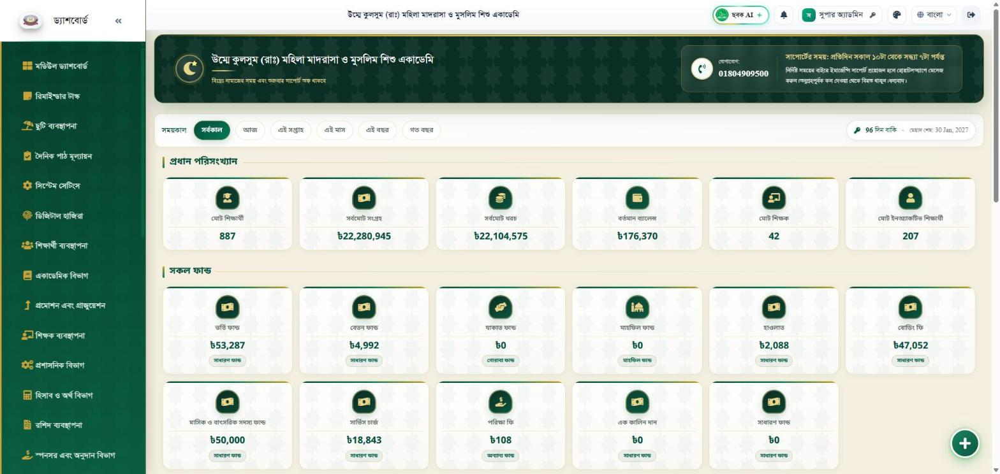
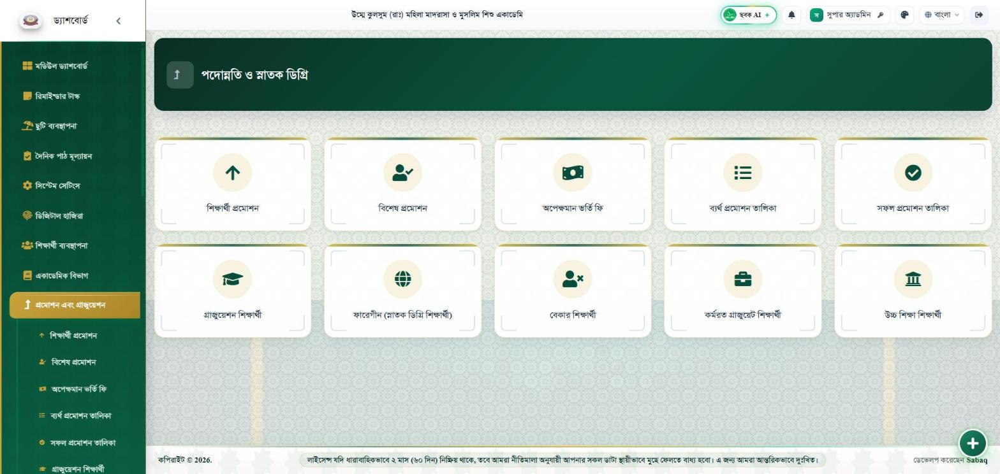
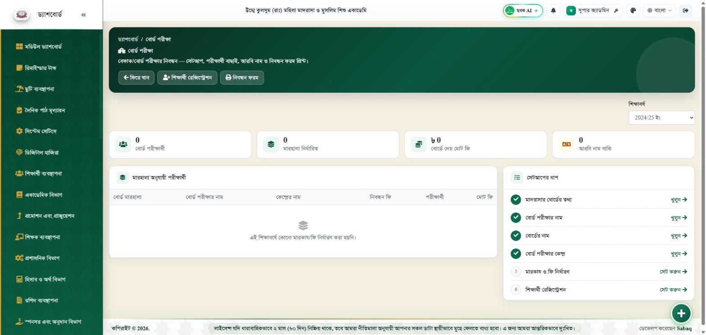
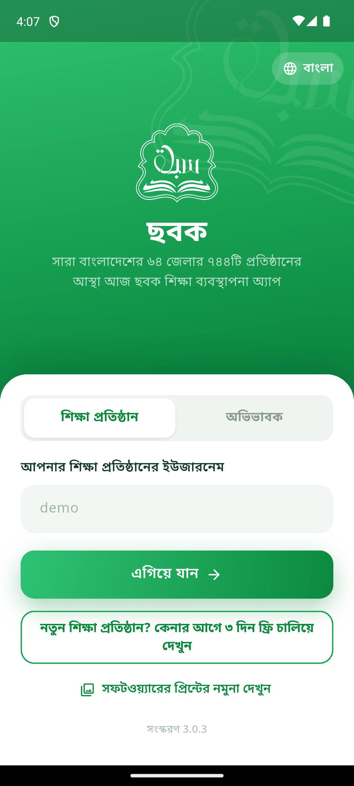
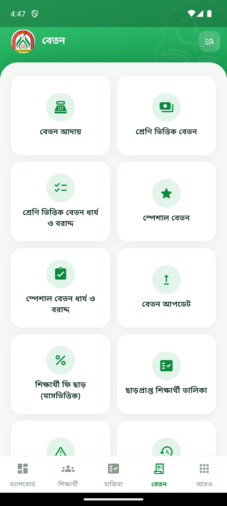
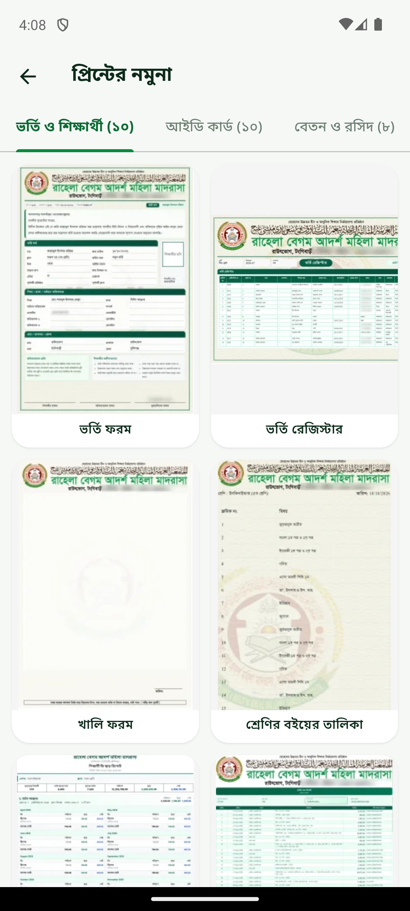

# Sabaq (ছবক): madrasa and school management

**Website:** [sabaaq.com](https://sabaaq.com) · **App:** [Play Store](https://play.google.com/store/apps/details?id=com.sabaaq.sabaq_app)

Sabaq is a Bangla-first management platform for madrasas and schools in Bangladesh. It replaces the paper registers an institution keeps for students, attendance, fees, exams, salaries, donations and board registrations, and gives guardians a phone app to follow their children.

> This repository is the public overview of a commercial product. The application source is private; what you find here is the architecture, the feature set, the release history and screenshots.

## At a glance

- 700+ institutions, 64 districts of Bangladesh
- One isolated site and database per institution, all on one managed fleet
- Web application (Laravel) for the office, Android app (Flutter) for staff and guardians
- Bangla, English and Arabic interface
- Sales through WhatsApp; a self-serve free trial pipeline is in the code (ran 2026-10-16 to 27, paused, see below)

## Screenshots

| Web dashboard | Promotion and graduation | Board exam module |
|---|---|---|
|  |  |  |

| App start | App fees | App print gallery |
|---|---|---|
|  |  |  |

## Modules

**Students:** admission, sessions, classes and sections, roll and ID arrangement, ID cards, certificates, transfer certificates, inactive students, data export, online admission with online payment.

**Attendance:** manual and biometric device attendance (ZKTeco ADMS, RFID), shifts for students, teachers and staff, live preview, SMS to guardians on entry and exit.

**Fees and accounts:** class-based and special fees, monthly dues, discounts, receipts with printed receipt-book stock tracking, funds, income and expense, balance sheet, annual report, audit report, assets.

**Exams and results:** exam setup, seat numbers, admit cards, routines, mark entry, GPA and average-based results, tabulation sheets, merit lists, result SMS, teacher-wise results, 4th (additional) subject.

**Board exam:** institution board profile, exam and board names, centres (markaz), fee settings per marhala, examinee registration, Arabic and English name profiles, registration forms, consent letters and ilhaq application forms printed from system data.

**Teachers and staff:** recruitment, documents, subject and class assignment, attendance, leave, salary, increments, ID cards, duty roster.

**Sponsors and donations:** donor types, donors, monthly donors, orphan sponsorship, sponsor payments and dues.

**Boarding, hifz, library, loans and dues, notices, events, SMS gateway, multi-branch, website builder.**

## Architecture

```
 ┌──────────────────────┐      ┌──────────────────────┐
 │  Flutter app         │      │  Web browser          │
 │  staff + guardian    │      │  office staff         │
 └──────────┬───────────┘      └──────────┬───────────┘
            │ /api/v1 (Sanctum)           │ Blade + jQuery
            ▼                             ▼
 ┌────────────────────────────────────────────────────┐
 │  Laravel 11 tenant site  (one per institution)     │
 │  app/Http/Controllers/Api/V1/**   <- API layer     │
 │  app/Http/Controllers/*            <- web layer     │
 │  one MySQL database per tenant                     │
 └────────────────────────────────────────────────────┘
            ▲                             ▲
            │ overlay package             │ push (FCM)
 ┌──────────┴───────────┐      ┌──────────┴───────────┐
 │  fleet-deploy        │      │  notification        │
 │  370+ sites, gated   │      │  service             │
 └──────────────────────┘      └──────────────────────┘
```

Design rules that keep the fleet healthy:

- **The web application is the source of truth.** The API mirrors the web's forms field for field and reuses the web's services for every money calculation. A contract gate compares routes, permissions and formulas on every build and fails when they drift.
- **Delta overlay packages.** A deployment ships only the files that differ from the vendor drop, with an md5 prerequisite list, so a stale copy can never silently roll a site back.
- **Every site is checked after deployment:** PHP lint, `/api/v1/config` HTTP 200, web boot probe, push provider registration. Failures roll back that one site.
- **Money is never computed on the phone.** The app shows amounts the server formatted; PHP's `number_format` is reproduced in Dart ([php-number-format-dart](https://github.com/fokhrolislam/php-number-format-dart)) only for display of legacy values.
- **Production MySQL columns are often `varchar` where the test database has `int`.** Every API value goes through crash-safe parsing ([bangla-utils-dart](https://github.com/fokhrolislam/bangla-utils-dart)); raw casts are banned by a scanner ([flutter-risk-scans](https://github.com/fokhrolislam/flutter-risk-scans)).

## Free trial pipeline (paused since 2026-10-27)

The pipeline below ran for eleven days and produced one paying institution. On 2026-10-27 the owner paused it to sell through WhatsApp conversations instead: a server switch answers trial requests from older app versions with a short message and a WhatsApp link, the app hides the entry points behind a feature flag, and the trial sites were removed to free fleet storage. Everything stays in the code and switches back on in one step on each side.

1. A pool of empty trial sites is prepared in advance from a master copy of the current release.
2. A guardian or office opens the app, taps "free trial", confirms their number with a WhatsApp code.
3. A pool site is assigned within seconds: 3 free days, 1 read-only day, then automatic removal.
4. On purchase, the trial site is promoted in place: subdomain, database and database user renamed to the institution's name, licence written, web panel unlocked. Nothing is re-entered.

## Release history (app)

| Version | Date | Highlights |
|---|---|---|
| 3.0.3 | 2026-10-25 | WhatsApp trial code, dashboard total-due card, print gallery for everyone, 4th subject, per-shift attendance edit |
| 3.0.2 | 2026-10-21 | Bundled institution list for login, richer trial form, trial push ping |
| 3.0.1 | 2026-10-17 | First-install guided tour |
| 3.0.0 | 2026-10-16 | Offline-first writes, 3-day free trial, profile shortcuts |
| 2.4.6 | 2026-10-09 | English and Arabic interface, permission editor |
| 2.4.5 | 2026-10-03 | Print preview equals printed output |

## Contact

Fokhrol Islam · [sabaaq.com](https://sabaaq.com) · Dhaka, Bangladesh
